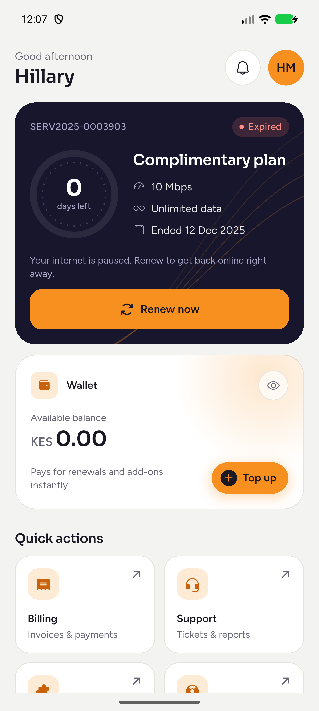
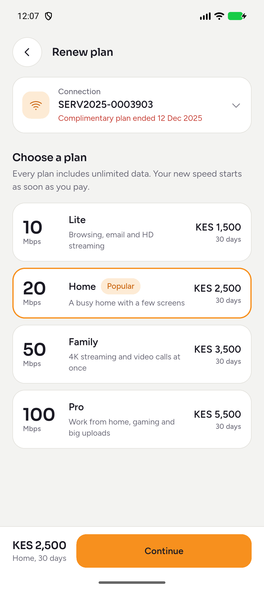
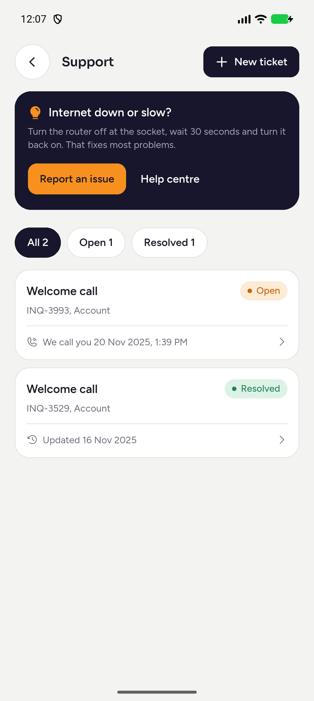
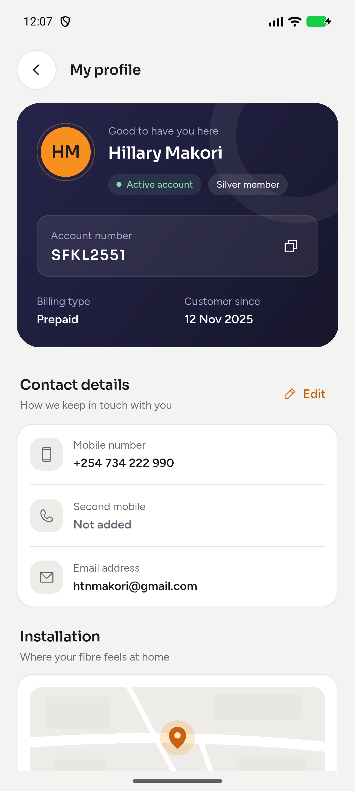
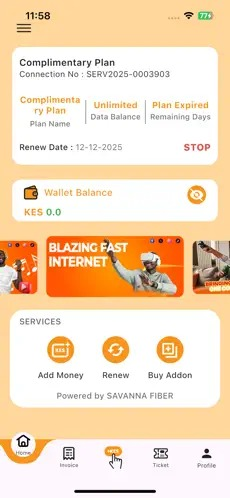
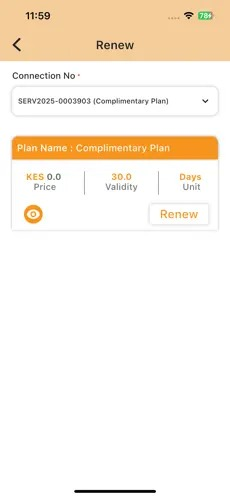
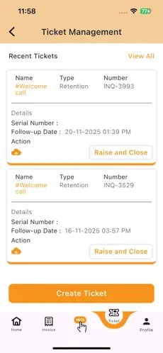
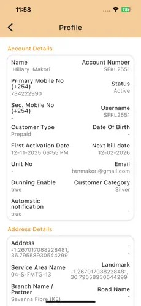

# Savanna Fibre app

A redesign of the Savanna Fibre customer app in Flutter. Frontend only: all data is mocked, so every flow (sign in, renew, top up, add-ons, tickets) works end to end without a backend.## Redesigned screens


Screenshots captured from the Flutter app running on Android with demo data. Select an image to view it at full size.

| Home | Renew | Support / Tickets | Profile |
|---|---|---|---|
| [](docs/screenshots/redesigned/home.png) | [](docs/screenshots/redesigned/renew.png) | [](docs/screenshots/redesigned/ticket.png) | [](docs/screenshots/redesigned/profile.png) |

## Original Savanna Fibre screens

These screenshots show the original app used as the reference for this redesign. Select an image to view it at full size.

| Home | Renew | Tickets | Profile |
|---|---|---|---|
| [](docs/screenshots/original/home.jpeg) | [](docs/screenshots/original/renew.jpeg) | [](docs/screenshots/original/ticket.jpeg) | [](docs/screenshots/original/profile.jpeg) |

## Run it

This folder holds the Dart code but no platform folders yet. From inside it:

```bash
flutter create . --org ke.savannafibre --platforms android,ios
flutter pub get
flutter run
```

`flutter create .` only adds the missing `android/` and `ios/` folders; it won't overwrite `lib/` or `pubspec.yaml`.

Sign in with any Kenyan mobile number (or account number `SFKL2551`), then any 6-digit code.

## Stack

| Concern | Choice | Why |
|---|---|---|
| State | `flutter_riverpod` 3 (Notifier API, no code generation) | Less boilerplate than Bloc, compile-safe, easy to test |
| Navigation | `go_router` with a `StatefulShellRoute` | Tabs keep their scroll position; auth redirects live in one place |
| Type | `google_fonts`: Sora for numbers and headings, Figtree for reading text | |
| Icons | `phosphor_flutter` | One consistent icon family |
| Motion | `flutter_animate` | One entrance on Home, confirmation animations, nothing ambient besides the fibre strands |

## Structure

```
lib/
├── main.dart, app.dart
├── core/
│   ├── theme/        colours (SfPalette), type, spacing, ThemeData light + dark
│   ├── router/       go_router config and auth redirect
│   ├── utils/        KES, date and phone formatting
│   └── widgets/      UI kit: SfCard, SfButton, SfStatusChip, SfGroup, SfInfoRow,
│                     FibreRing, FibreStrands, SavannaMark, sheets, bottom nav
├── data/
│   ├── models/       Customer, Plan, Connection, Addon, Wallet, Invoice, Ticket
│   ├── mock/         seed data taken from the current app screens
│   └── repositories/ AccountRepository interface + MockAccountRepository
├── state/            Riverpod providers and controllers
└── features/
    ├── auth/         sign in, OTP
    ├── home/         plan card, wallet, quick actions, offers
    ├── renew/        plan picker and checkout
    ├── plans/        add-ons
    ├── payments/     wallet / M-Pesa payment sheet
    ├── wallet/       M-Pesa top-up
    ├── billing/      invoices, payments, invoice detail
    ├── tickets/      list, detail with timeline, create
    ├── profile/      account, contact, installation, preferences
    ├── help/         contact options, FAQs
    └── shell/        tab scaffold with floating nav
```

## Connecting the backend

Everything the UI needs from the server goes through `AccountRepository` in `lib/data/repositories/account_repository.dart`. Write an HTTP implementation of it and change one line in `lib/state/account_providers.dart`:

```dart
final accountRepositoryProvider = Provider<AccountRepository>((ref) => ApiAccountRepository());
```

The controllers in `lib/state/` then need their `build()` methods switched from `MockData` to repository calls (make them `AsyncNotifier`s at that point).

## Placeholders to replace

- **Plan prices and add-ons** in `lib/data/mock/mock_data.dart` are invented. Swap in the real price list.
- **Logo**: `SavannaMark` is a drawn placeholder. Drop the real logo into `assets/` and swap it in.
- **Support phone, WhatsApp and email** on the Help screen show a snackbar until real contacts are added (use `url_launcher`).
- **Map preview** on Profile is drawn, not a real map.
- **Fonts** download at runtime through `google_fonts`. For release, bundle the font files and set `GoogleFonts.config.allowRuntimeFetching = false`.

## What changed from the current app

- Plan state is unambiguous: one status chip (Active, Ends soon, Expired) and a ring showing days left, instead of "Plan Expired" under "Remaining Days" and an unexplained red STOP.
- Long plan names no longer break mid-word.
- The complimentary plan is no longer offered as a KES 0 renewal; paid plans are compared side by side.
- Renewal and add-ons share one payment sheet: wallet if the balance covers it, otherwise M-Pesa.
- Raw values are gone from Profile: `true`/`false` became switches, empty fields became prompts, and GPS coordinates sit under a map preview.
- Tickets show a status and a timeline. "Raise and Close" became "Mark resolved", with a confirmation.
- Help is reachable from Home, Support and Profile, not a centre tab.
- Dark mode, larger touch targets and screen-reader labels throughout.
